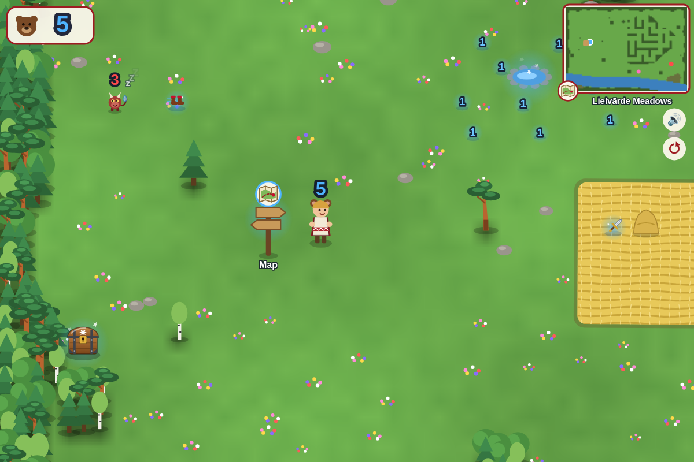
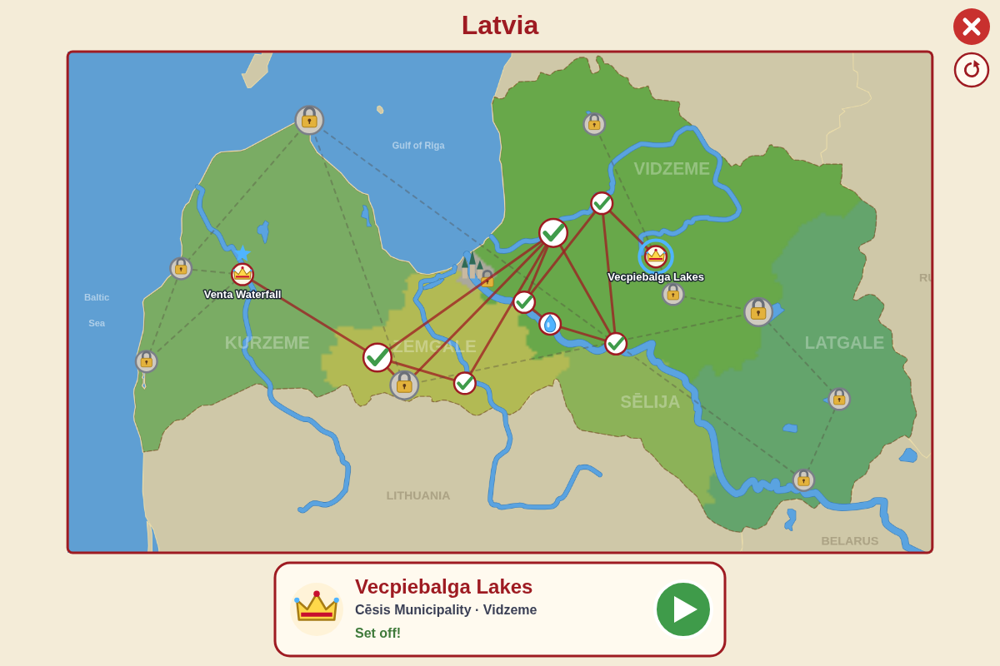

# Lāčplēsis / Bearslayer

A top-down browser game for young children, set in Latvia. Lāčplēsis, the bear-eared hero of
the Latvian epic, travels from place to place on a map of Latvia. Each place is small (a couple of
meadows, a piece of forest, sometimes a lake, the coast or a big bridge), and in each he beats
monsters whose number is smaller than his own and then the place's boss, which opens the next
places. The text is in Latvian or English: the LV / EN switch on the title screen (or the L key) picks it,
and Latvian is the default. Based on `spec.md`.

There are 18 places across Vidzeme, Zemgale, Kurzeme and Latgale; Sēlija and Rīga come later.
The map of Latvia uses Natural Earth data (public domain).

The screenshots show the English text; the game starts in Latvian.

## Run

Open `index.html` in a browser. No server, build step or network is needed: all pictures and
sounds are generated in code.

To try every place without playing through: open it with `#visas` at the end of the address
(`index.html#visas`). Every place on the map is open from the start, but nothing is beaten and the
save keeps only what you really win.

To pick the language from the address, add `?lang=en` or `?lang=lv` (`index.html?lang=en`).

If frames get too slow, the game first stops the water moving (waves, river flow, the waterfall),
then lowers the drawing resolution. For checking speed on a device, `?fps=1` shows the frame rate
and resolution in a corner (`~` means the water has stopped), `?water=still` stops the water from
the start, and `?jods=live` draws Jods fully every frame instead of from his cached body
(`index.html?fps=1&water=still&jods=live`).

## How it plays

| Control | Keyboard | Mouse or touch |
|---|---|---|
| Move | arrow keys or WASD | tap or hold where to go |
| Map of Latvia | M | tap the minimap, or walk into the signpost |
| Pause | Esc | (opens when the window loses focus) |
| New game | R | button under the sound button, or under the ✖ on the map of Latvia |

- **Strength** is the blue number above Lāčplēsis's head. Enemies' numbers are red, or yellow
  while a debuff weakens them. An enemy he can beat trembles and sweats.
- **Fights** happen by walking into an enemy. A weaker one runs away and he gains part of its
  number. A stronger one just pushes him back: there is no death and no game over.
- **Scaling:** enemies and bosses are set relative to his strength whenever they are out of sight,
  and keep their number while on screen. A Jods's heads get theirs once, on the first visit, from
  his fighting strength with his weapons. Strength never goes above 999.
- **Drain:** strength slowly drops over time, but never below half of the best it has been.
- **Home:** blue digits float around the magic spring at Lielvārde, and the spring refills
  strength to its best.
- **Places:** pick one on the map of Latvia, a few per novads. Each is fixed every game, so it
  can be learned, and its forests are small mazes.
- **Burning and swimming:** with the torch (Lāpa, a major item) lit, walking into the trees burns a
  way through at once, for free, though each gap burns 5 s of the torch away; without it, pushing at them says "Atrodi lāpu!". Rivers and lakes
  can be swum after a confirm, at a cost in strength. Swamps by lakes and rivers slow
  him (and enemies) to half speed. Islands (in Inesis, and the Kolka lighthouse's island at the end
  of its reef) can only be swum to and always have valuable gifts.
- **Weapons and armour:** minor ones (sword, helmet, shield, seven-league boots) mostly lie
  around; major ones (iron club, Pērkons's axe, chain mail, Spīdola's broom, a sleep flute) come
  from chests and tautumeitas, and now and then lie on the ground. Each lasts a while and shows on him.
- **Helpers** live in log houses: Kurbads adds his strength in fights, Koknesis finds weapons, and
  Sprīdītis stops the drain and points to chests. Spīdola waits in a witch circle by Burtnieks and
  lends him her broom, flying along beside him.
- **Bosses:** most places have a crowned vadonis, some of them in a clearing at the centre of a
  forest labyrinth. Each region has a main boss: the Great Bear
  at Turaida, the three-headed Jods in Tērvete forest, the six-headed Jods at Kolka and Ragana the
  witch at Lubāns. Jods is a many-headed giant: his heads have to be beaten one by one and come
  round again, and he slams his club down where Lāčplēsis stands. Each boss
  leaves a golden chest that opens the next places.
- **Final boss:** once all four main bosses are beaten, Tērvete hillfort opens, where the
  nine-headed Jods waits.
- **Tautumeitas** in folk costume stand in every other place and give Lāčplēsis major weapons and gear (never the torch).

Progress is saved in the browser's `localStorage`.

## Development

All game code is in `game.js`; tuning values (`REGIONS`, `LOCATIONS`, `POWER_*`, `DECAY`, `GAIN`, the boss
factors and costs) are near the top. Syntax check:

    node --check game.js

Headless check of every location (reachability, bosses, burning, unlocking):

    node tools/check-locations.js
